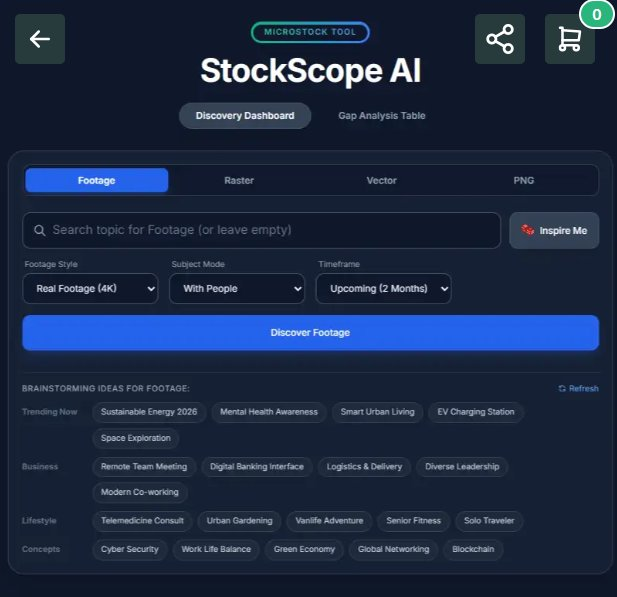

<div align="center">

# 📈 StockScope AI
### Microstock Trend Discovery & Market Gap Analysis Tool

<p align="center">
  <b>Temukan topik microstock dengan permintaan tinggi dan persaingan rendah (Market Gap), hasilkan 50 keyword SEO otomatis, dan buat prompt AI siap pakai dalam hitungan detik.</b>
</p>

[](https://dheaapriandi.github.io/stockscope-ai/)

<br>

[](https://github.com/dheaapriandi/stockscope-ai/stargazers)
[](LICENSE)
[](https://www.python.org/)
[](https://tailwindcss.com/)
[](#)

<br>



</div>

---

## 📖 Tentang StockScope AI

**StockScope AI** adalah platform intelijen pasar khusus kreator microstock (**Fotografer, Videografer, Ilustrator Vektor, & AI Artist**). 

Banyak kreator menghabiskan waktu memproduksi aset yang pasarnya sudah terlalu jenuh (*oversaturated*). StockScope AI hadir untuk memecahkan masalah tersebut dengan melakukan kalkulasi **Market Gap Analysis**:
$$\text{Opportunity Score} = f(\text{Search Volume High}, \text{Library Supply Low})$$

Dengan alat ini, Anda dapat langsung mengetahui topik apa yang sedang dicari pembeli komersial (*commercial buyers*) namun persediaannya masih sangat minim di perpustakaan stok.

---

## 🎯 Fitur Unggulan

### 1. 🔍 Discovery Dashboard (Multi-Asset)
- **4 Tipe Aset Terpisah**:
  - **Footage**: Real Footage 4K, Drone Aerial, Cinematic Slow-Mo, Time-lapse, Vertical 9:16.
  - **Raster**: Commercial Photography, Authentic Lifestyle, Studio Lighting, Flat Lay, Macro.
  - **Vector**: Flat Design, 3D Isometric, Minimalist Line Art, Infographics, UI Kits.
  - **PNG**: 3D High Gloss, Alpha Cutout, Transparent Splash/Smoke, Isolated Objects.
- **Filter Fleksibel**: Pilihan subjek (*With People, Architecture, Nature, Tech*) dan *Timeframe* (Spike 7 hari, 30 hari, hingga tren 2 bulan ke depan).

### 2. 🎲 Inspire Me & Brainstorming Ideas
- Kategori topik terkurasi siap riset: **Trending Now, Business, Lifestyle, Concepts, Technology, Healthcare**.
- Cukup **klik salah satu pill / tag**, analisis lengkap akan langsung diproses secara otomatis.

### 3. 📊 Gap Analysis Table (Tabel Celah Pasar)
- Tabel komprehensif yang menampilkan:
  - Estimasi volume pencarian bulanan (*Monthly Search Volume*).
  - Persentase kejenuhan pasar (*Market Saturation %*).
  - Skor peluang (*Opportunity Gap Score* 1–100).
  - Target industri pembeli (*Tech SaaS, Corporate ESG, Media Ads*).
- Fitur filter berdasarkan tipe aset dan tombol **Export Table ke CSV**.

### 4. 🏷️ Generator Judul SEO & 50 Keywords Otomatis
- Menghasilkan judul komersial yang dioptimalkan untuk algoritma pencarian.
- Menyediakan 45–50 keywords relevan dengan fitur **Copy All** (format koma) siap paste ke panel submitter microstock.

### 5. 🤖 Prompt Generator untuk Generative AI
- **Image Prompt**: Siap pakai untuk Midjourney v6.1, FLUX.1, Google Imagen 3, Stable Diffusion.
- **Video Prompt**: Siap pakai untuk Runway Gen-3, Luma Dream Machine, Kling AI, OpenAI Sora.

### 6. 🛒 Saved Collections & Batch CSV Export
- Simpan topik-topik bernilai tinggi ke keranjang ide.
- Ekspor seluruh koleksi ke format CSV standar yang kompatibel dengan uploader **Adobe Stock** dan **Shutterstock**.

---

## ⚡ Cara Menjalankan

### Cara 1: Akses Langsung Online (Tanpa Install)
Kunjungi Live Demo:
👉 **[https://dheaapriandi.github.io/stockscope-ai/](https://dheaapriandi.github.io/stockscope-ai/)**

---

### Cara 2: Menjalankan di Komputer Lokal (Windows)
1. Clone repositori ini:
   ```bash
   git clone https://github.com/dheaapriandi/stockscope-ai.git
   cd stockscope-ai
   ```
2. **Klik 2x** file:
   ```text
   Buka_StockScope_AI.bat
   ```
   Aplikasi akan otomatis berjalan di browser pada alamat `http://localhost:5055`.

---

### Cara 3: Menggunakan Python Server & CLI
- **Menjalankan Web Server:**
  ```bash
  python app.py
  ```
- **Menjalankan via Command Line (CLI):**
  ```bash
  python stockscope.py --topic "EV Charging Station" --type footage
  ```

---

## 📁 Struktur Direktori

```text
stockscope-ai/
├── assets/
│   └── preview.jpg             # Tangkapan layar antarmuka aplikasi
├── index.html                  # Antarmuka Web responsif (Tailwind CSS + Glassmorphism)
├── app.py                      # Local HTTP server & REST API backend
├── stockscope.py               # Core trend intelligence engine & CLI analyzer
├── Buka_StockScope_AI.bat      # 1-klik launcher untuk pengguna Windows
├── requirements.txt            # Dependensi Python minimal
├── LICENSE                     # Lisensi open-source MIT
└── README.md                   # Dokumentasi proyek
```

---

## 🛠️ Kompatibilitas Marketplace

Format metadata dan keyword yang dihasilkan telah disesuaikan dengan standar:
- [x] **Adobe Stock Contributor**
- [x] **Shutterstock Premier / Contributor**
- [x] **Freepik Contributor**
- [x] **Getty Images / iStock ESP**
- [x] **Pond5 & Envato Elements**

---

## 📄 Lisensi & Kontribusi

Proyek ini berlisensi [MIT](LICENSE) © 2026 **[Dhea Mohamad Apriandi](https://github.com/dheaapriandi)**.  
Dipersilakan untuk menggunakan, memodifikasi, dan mengembangkan alat ini. Kontribusi melalui Pull Request dan Issues sangat terbuka!
